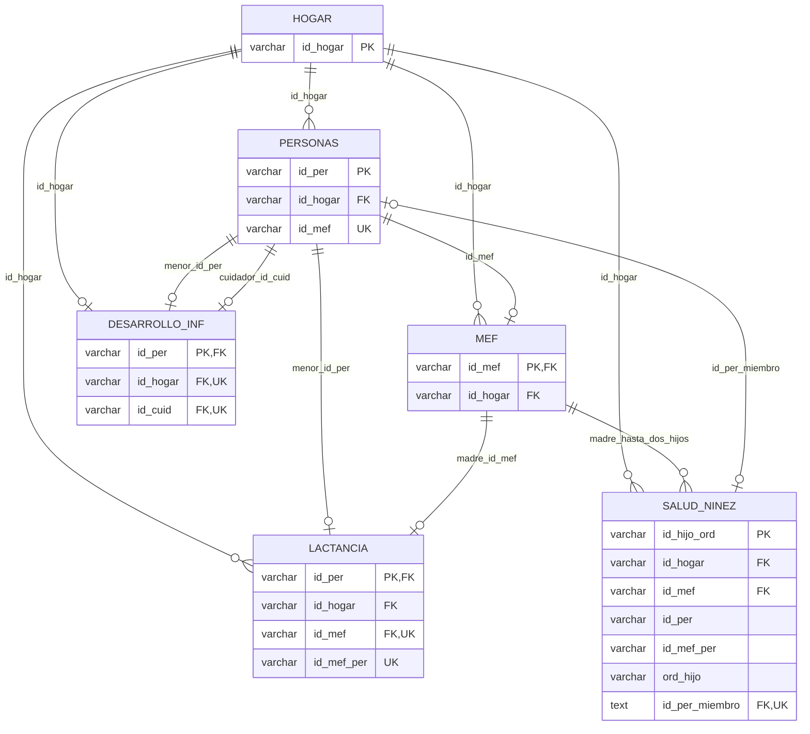

# MODELO ENTIDAD-RELACIÓN ENDI R2

1. **Objetivo.** Mantener integridad de las seis tablas en research_lab.endi mediante 6 PK, 12 FK, 7 UNIQUE, 11 CHECK y NOT NULL en los identificadores obligatorios. El modelo se crea después del mapeo y COPY, dentro de la misma transacción de recarga. No se eliminan registros para hacer cumplir restricciones.

2. **Fuente documental.** Se leyó la guía completa `02_DOCUMENTACION/02_GUIA_BASE_DATOS_ENDI_R2.PDF`, 24 páginas. El Cuadro 2, pp. 9–12, define granularidades y llaves; p. 13 define claves; pp. 15–17 y Cuadro 4 describen población y relaciones; p. 17 recomienda id_hijo_ord para Salud; Cuadro 7, p. 19, explica los identificadores; pp. 20–21 describen ausentes y validaciones. Se revisaron visualmente las tablas de pp. 16, 17 y 19. Las sentencias SQL son la implementación de esas reglas contrastada con los datos, no código SQL publicado por el INEC.

3. **Archivos.** `03_PROCESOS_ETL/05_MODELO_RELACIONAL.py` centraliza declaraciones, SQL, aplicación y verificación. `01_ETL_FUENTES.py` lo llama al recargar y `04_GESTION_PROYECTO.py` informa la comprobación. `02_DOCUMENTACION/08_MAPEO_ENDI/04_RESTRICCIONES_POSTGRESQL.sql` contiene el DDL reproducible. Las pruebas locales están en `03_PROCESOS_ETL/05_PRUEBAS/03_PRUEBAS_MODELO.py`; se excluyen de GitHub junto con los reportes. AGENTS.md y la skill Python remiten a este módulo.

4. **Flujo paso a paso.** Se verifican fuentes y mapeo aprobado; se remapean las seis fuentes; se abre una transacción; se sustituyen las tablas y se comprueban filas, tipos y nulos. Después se bloquean las seis tablas para aplicar el modelo, se reconstruyen únicamente las restricciones nombradas por este módulo, se añade la columna calculada si falta, se fijan NOT NULL, PK, UNIQUE, CHECK, FK e índices auxiliares y se comprueba el catálogo. Solo entonces se confirma la transacción. Una incompatibilidad revierte conjuntamente carga y modelo.

5. **Entradas.** Seis fuentes originales y diccionarios del manifiesto, tres PDF para control de integridad, configuración PG* y credencial externa, servidor PostgreSQL y permisos para sustituir las seis tablas. El helper acepta conexión con transacción activa y nombre de esquema validado; el CLI limita su destino a la configuración research_lab.endi. No se requieren pruebas locales para ejecutar desde GitHub.

6. **Salidas.** Modelo físico validado, SQL público reproducible e informe `09_VALIDACIONES/12_RECARGA_POSTGRESQL.json` con modelo_relacional, definiciones y huella del catálogo. El catálogo de mapeo conserva sus 1.423 variables fuente. Se añade **una columna derivada** física: Salud pasa de 413 a 414 columnas, con 1.424 columnas físicas entre las seis tablas. Los RDS y sus valores no cambian.

7. **Claves primarias y únicas.** Las PK identifican el registro según su granularidad. Las UNIQUE secundarias expresan las cardinalidades del manual sin obligar a todas las personas a aparecer en todos los formularios.

| Tabla | PK | UNIQUE adicionales |
| --- | --- | --- |
| endi.f1_hogar | id_hogar | — |
| endi.f1_personas | id_per | id_mef, nullable para personas que no son MEF |
| endi.f2_mef | id_mef | — |
| endi.f2_lactancia | id_per | id_mef; id_mef_per |
| endi.f2_salud_ninez | id_hijo_ord | id_per_miembro; (id_mef, ord_hijo) |
| endi.f3_desarrollo_inf | id_per | id_hogar; id_cuid |

8. **Relaciones físicas.** Toda FK usa ON UPDATE NO ACTION y ON DELETE RESTRICT. No se propagan borrados ni se inventan hogares, madres o personas para completar cruces.

| Tabla hija | Columna | Tabla y clave padre |
| --- | --- | --- |
| f1_personas | id_hogar | f1_hogar.id_hogar |
| f2_mef | id_hogar | f1_hogar.id_hogar |
| f2_mef | id_mef | f1_personas.id_mef |
| f2_lactancia | id_hogar | f1_hogar.id_hogar |
| f2_lactancia | id_mef | f2_mef.id_mef |
| f2_lactancia | id_per | f1_personas.id_per |
| f2_salud_ninez | id_hogar | f1_hogar.id_hogar |
| f2_salud_ninez | id_mef | f2_mef.id_mef |
| f2_salud_ninez | id_per_miembro | f1_personas.id_per |
| f3_desarrollo_inf | id_hogar | f1_hogar.id_hogar |
| f3_desarrollo_inf | id_per | f1_personas.id_per |
| f3_desarrollo_inf | id_cuid | f1_personas.id_per |



9. **Excepciones comprobadas.** Salud contiene 171 id_per terminados en 77, correspondientes a no miembros; el manual permite que esos códigos se repitan. Por ello no se define PK ni UNIQUE general sobre id_per o id_mef_per de Salud. id_per_miembro es TEXT GENERATED ALWAYS AS (CASE WHEN right(id_per::text,2)='77' THEN NULL ELSE id_per::text END) STORED: permite una FK real únicamente para miembros y conserva id_per original. Los 22.017 miembros sí tienen correspondencia en Personas. Los 324 cuidadores que no figuran en MEF sí pertenecen a Personas, por lo que su FK va a Personas. Los 30.417 id_mef no nulos de Personas incluyen mujeres fuera de las 19.846 madres de MEF; la FK correcta va de MEF hacia Personas, no al revés. Se encontraron seis id_mef_per de Lactancia sin correspondencia en Salud: ese cruce analítico no se impone como FK; los registros se conservan y las tablas se relacionan a través de Personas, MEF y Hogar.

10. **CHECK y NOT NULL.** Se valida la estructura decimal de id_upm (10 caracteres), id_viv (12), id_hogar (14) y los identificadores de personas (16), junto con sus prefijos jerárquicos. Se comprueba id_mef=id_per cuando la clave secundaria está presente en Personas; id_mef_per=id_mef concatenado con los dos dígitos del menor en Lactancia/Salud; ord_hijo pertenece a 01/02 e id_hijo_ord concatena id_mef_per y ord_hijo; cuidador y menor son distintos. Los identificadores obligatorios son NOT NULL. Los ausentes de preguntas, códigos 88/99/999/9999 y flujos no aplicables se preservan; no se añaden límites genéricos a las 1.423 preguntas sin una regla documental específica.

11. **UI y server.** No hay interfaz Shiny. La consola del coordinador confirma PK, FK y restricciones después de validarlas. `reglas_modelo()` y `columnas_obligatorias()` devuelven declaraciones; `sentencias_modelo(esquema)` devuelve DDL determinista; `generar_sql(raiz, esquema)` escribe un único SQL; `aplicar_modelo(conexion, esquema)` ejecuta dentro de la transacción recibida y devuelve verificaciones; `verificar_modelo(conexion, esquema)` consulta restricciones validadas, columnas NOT NULL y la expresión calculada sin escribir. Ninguna importación aplica DDL.

12. **SQL e índices.** El DDL retira primero las doce FK propias y luego las UNIQUE/CHECK/PK propias, sin CASCADE; así se puede aplicar de nuevo sin duplicar restricciones. Una dependencia ajena que necesite una de esas claves bloquea la operación y revierte la transacción. Se añaden cuatro índices auxiliares sobre id_hogar en Personas, MEF, Lactancia y Salud; las demás FK ya tienen índices de PK/UNIQUE o del compuesto (id_mef,ord_hijo). La columna calculada se comprueba como STORED y con la expresión esperada. Los nombres y definiciones completos están en el SQL generado.

13. **Dependencias y ejecución.** Se reutilizan Python 3.15.0, SQLAlchemy y Psycopg 3 del entorno espol, sin nuevos paquetes. PostgreSQL 18.3 y Docker Linux/amd64 son el escenario ensayado. Desde la raíz, el mismo comando crea carga y modelo:

```powershell
docker compose -f 05_CONFIGURACIONES/compose.yaml run --build --rm recarga
```

Con las tablas ya cargadas, el autor puede verificar sin modificar datos; la credencial se proporciona externamente.

```powershell
conda run -n espol python -B 03_PROCESOS_ETL/05_MODELO_RELACIONAL.py verificar
```

Para reconstruir solamente el modelo existente se dispone de la acción aplicar, dentro de una transacción; no recarga los RDS ni elimina filas.

```powershell
conda run -n espol python -B 03_PROCESOS_ETL/05_MODELO_RELACIONAL.py aplicar
```

14. **Validaciones y pruebas.** Antes de implementar se consultaron nulos, unicidad, longitudes, prefijos y cobertura de relaciones. Las reglas de identificadores dieron cero incumplimientos. Las pruebas de integración en un esquema sintético revertido comprueban aplicación repetida; rechazo de PK duplicada, FK huérfana, orden inválido, cuidador igual al menor, NULL obligatorio, prefijo inválido y borrado de padre; aceptación de cuidadores no MEF y de dos niños no miembros que comparten id_per e id_mef_per. Las comprobaciones de carga completa y repetición se registran localmente; no se publican pruebas ni logs.

15. **Riesgos y rendimiento.** Aplicar claves e índices necesita bloqueos, memoria y espacio. La recarga reconstruye las seis tablas y las restricciones propias; no preserva otros índices o permisos particulares de esas tablas. Se mantienen los guardas de transacción y DROP RESTRICT frente a dependencias externas. La columna calculada añade almacenamiento; no cambia los originales ni altera el catálogo fuente. Las relaciones del manual expresan cruces posibles entre poblaciones con coberturas distintas, no inclusión obligatoria de cada tabla en todas las demás.

16. **Cambios realizados.** Se implementó el modelo relacional que antes estaba diferido, se añadió SQL público, se integró su creación a la recarga atómica y se actualizaron agente, skill y documentación. La autorización actual sustituye el aplazamiento anterior. El mapeo independiente sigue sin crear restricciones ni conectarse a PostgreSQL y conserva sus tres hashes aprobados.

17. **Límites y referencias.** No se construyen tablas vacías de UPM/vivienda ni catálogos artificiales para aparentar relaciones; las seis fuentes quedan conectadas con claves reales. Los cruces analíticos deben elegir LEFT/INNER/FULL JOIN según población y factor de expansión. La implementación utiliza [restricciones de PostgreSQL](https://www.postgresql.org/docs/18/ddl-constraints.html) y [columnas generadas STORED](https://www.postgresql.org/docs/18/ddl-generated-columns.html); no se definen CHECK que consulten otras tablas.

18. **Resultado comprobado de esta implementación.** Se ejecutó el flujo completo desde Windows/Conda y nuevamente desde una distribución filtrada en Docker Linux sin pruebas incluidas. Ambas recargas obtuvieron 177.439 filas, 1.423 variables fuente y una derivada, con idénticas huellas de contenido y definiciones del modelo: 6 PK, 12 FK, 7 UNIQUE y 11 CHECK validadas. La suite local de integración del modelo pasó en Windows; en Linux pasaron conjuntamente 40 casos de mapeo, recarga y modelo con las pruebas montadas solo para comprobar, sin incluirlas en la imagen ni en GitHub. Evidencias locales: 18_PRUEBAS_MODELO.txt, 19_RECARGA_CON_MODELO.txt, 20_CONTENEDOR_CON_MODELO.txt y 21_REPETICION_MODELO.json.

19. **Diccionario del modelo.** Las seis fuentes conservan este modelo. La sincronización posterior añade endi.diccionario_variables y endi.diccionario_restricciones, con dos PK y dos FK propias, validaciones de metadatos y comentarios de las 1.424 columnas. Las 66 restricciones de las fuentes, incluidos sus 30 NOT NULL, quedan descritas en 96 vínculos. La vista y el diagrama de metadatos se explican en 10_DICCIONARIO_VARIABLES.md; esos enlaces documentales no convierten valores encuestados en nombres de columnas.
