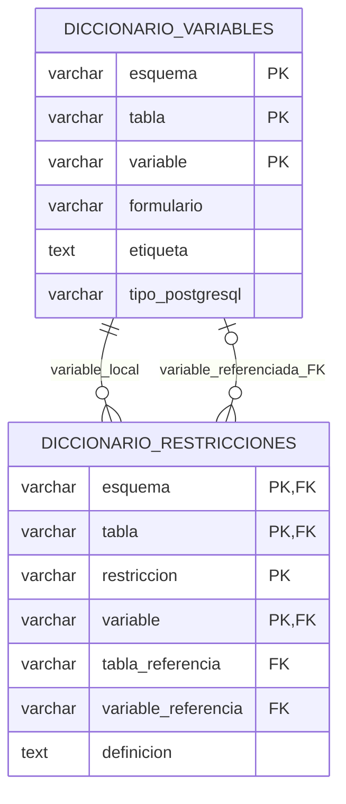

# DICCIONARIO DE VARIABLES Y RESTRICCIONES EN POSTGRESQL

1. **Objetivo.** Consultar en una sola tabla qué significa cada variable de las seis fuentes ENDI y relacionarla con sus claves, restricciones y columnas referenciadas. El diccionario y sus vínculos se actualizan en la misma transacción de la recarga.
2. **Archivos.** `03_PROCESOS_ETL/07_DICCIONARIO_VARIABLES.py` implementa lectura, mapeo, carga, comentarios y verificación. `01_ETL_FUENTES.py` lo ejecuta después del modelo; `02_MAPEO_POSTGRESQL.py` admite TEXT explícito; `04_GESTION_PROYECTO.py` informa la comprobación. El manifiesto se actualiza a versión 2. Los artefactos públicos son `08_MAPEO_ENDI/05_DICCIONARIO_POSTGRESQL.sql` y `06_MAPEO_DICCIONARIO.csv`. Las pruebas locales están en `05_PRUEBAS/04_PRUEBAS_DICCIONARIO.py` y no se publican.
3. **Entrega documental actual.** El archivo `01_DATOS_FUENTE/07_DICCIONARIO_ENDI.xlsx` ahora contiene seis hojas y 1.423 variables. El archivo 08 separado ya no está presente; no se necesita para esta entrega consolidada. Se comprobó que los nombres y etiquetas de las seis hojas coinciden con el catálogo anterior, incluyendo los cinco aliases de Desarrollo Infantil. Se actualizó intencionadamente el hash del Excel 07 a `4ffaab0a21762b5038f7ce322c2a71fc376d0eaefab3247d616c8efa31ebde06`; las seis fuentes RDS y los tres hashes aprobados del mapeo no cambian. Hay diez entradas controladas: seis RDS, un XLSX y tres PDF. Esta actualización documentada sustituye la entrega anterior de dos diccionarios; no se aprueban diferencias automáticamente.
4. **Flujo paso a paso.** Se verifican hash y hojas del Excel; se conservan Variable/Etiqueta y se normalizan solo espacios de encabezados/nombres. Se resuelven aliases explícitos y se añade la etiqueta documentada de id_per_miembro. Se contrasta cada variable con pg_attribute, tipo, posición y nulabilidad. Se obtienen restricciones reales de pg_constraint y sus columnas ordenadas. Se mapean ambos conjuntos antes del COPY; se crean o comprueban las tablas; se instalan validaciones; se vacían primero los vínculos y después el diccionario; se cargan completos y se escriben los comentarios de columnas. Solo tras comprobar conteos, claves y comentarios se confirma la transacción del llamador.
5. **Entradas.** Excel 07 y manifiesto versión 2, seis tablas físicas existentes con su modelo aplicado, conexión PostgreSQL 18.3 y permisos para crear metadatos, funciones, triggers, vista y comentarios. No se alteran contraseñas ni configuración del servidor. La carga completa obtiene la credencial mediante el mecanismo externo existente; el comando independiente requiere PG* o pgpass disponible.
6. **Salidas y conteos comprobados.** `endi.diccionario_variables`: 1.424 filas, de ellas 1.423 del Excel y una derivada. `endi.diccionario_restricciones`: 96 vínculos correspondientes a 66 restricciones de las fuentes (PK, FK, UNIQUE, CHECK y NOT NULL). `endi.v_diccionario_variables`: consulta simplificada con es_pk, es_fk, es_unique y nombres de restricciones. Se comprueban 1.424 comentarios de columna. La salida JSON incluye cobertura, conteos y hash del contenido sin OID, fechas ni rutas personales.
7. **Tabla de diccionario único.** La PK es (esquema, tabla, variable), porque un nombre como id_hogar aparece en varias tablas. Los campos son esquema, tabla, variable, formulario, etiqueta, archivo_diccionario, hoja, variable_diccionario, procedencia, posicion, tipo_postgresql y admite_nulos. Etiqueta usa TEXT; los identificadores y procedencias usan VARCHAR de longitud observada más diez; posición usa SMALLINT y nulabilidad BOOLEAN. La procedencia distingue excel/derivada; los campos de Excel son nulos solo para la columna calculada. La tabla auxiliar no es otro diccionario: registra las múltiples restricciones de una misma variable.
8. **Vínculos y constraints.** La PK auxiliar es (esquema, tabla, restriccion, variable); su posición es única por restricción. Una FK enlaza la variable local con el diccionario; otra enlaza tabla_referencia/variable_referencia con la entrada padre, compartiendo esquema. CHECK exige referencias completas únicamente para FOREIGN KEY. En este modelo todas las referencias pertenecen a endi; una referencia a otro esquema se rechaza expresamente. ON DELETE RESTRICT impide borrar entradas utilizadas. Los identificadores de madres, hogares o personas de las filas encuestadas no se convierten en referencias a textos como «id_per»: eso confundiría valores con nombres de columnas.



9. **Existencia física y coherencia.** Dos CONSTRAINT TRIGGER comprueban cada inserción/actualización. ct_diccionario_columna contrasta nombre, posición, tipo, nulabilidad y carácter derivado con pg_attribute. ct_diccionario_restriccion comprueba nombre, tipo, columna, posición, definición y destino contra pg_constraint. Las FK no apuntan a catálogos internos de PostgreSQL; los triggers y la comprobación del ETL aseguran la correspondencia de metadatos con el esquema físico en el momento de carga.
10. **UI y consultas.** DBeaver puede mostrar la etiqueta mediante el comentario nativo de cada columna después de actualizar sus metadatos. Para consultas SQL se utiliza la vista, o el diccionario unido a sus vínculos. Los nombres originales de las columnas y sus valores no cambian y no se renombran automáticamente los encabezados de resultados SQL.

El usuario consulta todas las variables de una tabla con sus etiquetas y papel en las claves.

```sql
SELECT formulario, tabla, variable, etiqueta, tipo_postgresql,
       admite_nulos, es_pk, es_fk, restricciones
FROM endi.v_diccionario_variables
WHERE tabla = 'f1_personas'
ORDER BY posicion;
```

Para ver cada FK con el significado de la variable local y de la variable referenciada:

```sql
SELECT r.tabla, r.variable, d.etiqueta, r.restriccion,
       r.tabla_referencia, r.variable_referencia,
       padre.etiqueta AS etiqueta_referenciada
FROM endi.diccionario_restricciones r
JOIN endi.diccionario_variables d
  USING (esquema, tabla, variable)
JOIN endi.diccionario_variables padre
  ON padre.esquema = r.esquema
 AND padre.tabla = r.tabla_referencia
 AND padre.variable = r.variable_referencia
WHERE r.tipo_restriccion = 'FOREIGN KEY'
ORDER BY r.tabla, r.restriccion, r.posicion;
```

Para identificar una variable concreta sin confundir nombres compartidos entre tablas:

```sql
SELECT *
FROM endi.v_diccionario_variables
WHERE tabla = 'f2_salud_ninez'
  AND variable = 'id_per_miembro';
```

11. **Funciones y servidor.** leer_excel(raiz, esquema) devuelve etiquetas verificadas; preparar(raiz, conexion, esquema) devuelve DataFrames normalizados, tipos y mapeos; tablas_metadatos() construye las dos tablas y sus constraints; sql_complementario() devuelve funciones, triggers, índices y vista; cargar_diccionario() actualiza datos y comentarios en la transacción recibida, sin commit interno. La recarga completa lo llama después de aplicar el modelo y antes del commit final. Los imports no abren conexiones ni escriben.
12. **SQL/ETL e idempotencia.** CREATE TABLE conserva estructuras existentes si sus tipos coinciden con el mapeo; una estructura distinta exige migración explícita. DELETE/COPY se ejecuta dentro de una sola transacción, con RESTRICT para dependencias externas y bloqueo de las seis fuentes durante la sincronización. Las dos FK de metadatos vinculan filas del diccionario, no los valores de los microdatos. Se añaden índices por variable local y referenciada. La vista no depende de los datos de las fuentes y no bloquea su reconstrucción. Los comentarios usan identificadores y literales escapados con Psycopg.
13. **Dependencias y ejecución.** Se reutilizan pandas, openpyxl, SQLAlchemy y Psycopg 3 del entorno espol; no se añaden paquetes. La carga completa conserva el comando habitual y recrea fuentes, modelo y diccionario juntos.

```powershell
docker compose -f 05_CONFIGURACIONES/compose.yaml run --build --rm recarga
```

Si solo se necesita sincronizar el diccionario de unas fuentes ya cargadas y con su modelo aplicado, el usuario proporciona la credencial externamente y ejecuta:

```powershell
conda run -n espol python -B 03_PROCESOS_ETL/07_DICCIONARIO_VARIABLES.py --cargar
```

14. **Validaciones y pruebas.** Se compararon todas las etiquetas del Excel consolidado con el catálogo previo: sin diferencias. Se verifican cobertura de las seis tablas, ausencia de duplicados, 1.424 columnas físicas descritas y correspondencia de comentarios. Las pruebas integradas comprueban TEXT de 50.000 caracteres, rechazo de NUL, aliases, carga repetida, FK y validaciones de nombres/tipos/posiciones/referencias. Se rechazan restricciones inventadas y referencias a una variable existente pero incorrecta. Los esquemas de prueba se revierten; las pruebas y registros permanecen excluidos de GitHub.
15. **Riesgos y límites.** Un DDL manual posterior que renombre/elimine columnas requiere volver a sincronizar el diccionario: los triggers validan cambios del diccionario, no interceptan todo el DDL de la base. No se instalan event triggers globales. Las etiquetas nuevas requieren actualizar de forma documentada la entrega del Excel y su hash; no se amplían VARCHAR de tablas existentes silenciosamente. La carga necesita permisos y bloqueos; una excepción revierte toda la transacción. Los metadatos describen las seis fuentes, no se catalogan recursivamente a sí mismos.
16. **Cambios realizados.** Se consolidó la entrada en el Excel 07, se añadió soporte TEXT al mapeador común, se creó un diccionario único y su tabla auxiliar con FK/constraint triggers, se publican mapeo/DDL y se integró la sincronización al ETL. No se modificaron valores de las seis fuentes ni se retiraron relaciones previas.
17. **Referencias.** El diseño usa [pg_constraint y sus columnas ordenadas](https://www.postgresql.org/docs/18/catalog-pg-constraint.html), [constraints de PostgreSQL](https://www.postgresql.org/docs/18/ddl-constraints.html) y comentarios nativos de columnas. Las restricciones relacionan valores de filas; las asociaciones entre nombres de variables y el catálogo físico se comprueban expresamente con los constraint triggers descritos.

18. **Resultado comprobado de esta tarea.** La recarga completa se ejecutó en Windows (espol/Python 3.15.0) y Docker Linux amd64 desde una copia publicable sin pruebas. Ambos informes coinciden íntegramente: 177.439 filas fuente, 1.423 variables originales, una columna calculada, 1.424 entradas del diccionario, 66 restricciones fuente y 96 vínculos columna–restricción. Se verificaron las 1.424 etiquetas como comentarios de columnas y las dos PK/dos FK de metadatos. El SHA-256 del contenido del diccionario fue `38adee1c7b5feb27d24ebc00c692643d09be27dcfd871936c5beca7a7cf37fb7` en ambas plataformas. Las 43 pruebas integradas pasaron tanto en Windows como en Docker; los esquemas temporales se revirtieron. Se compararon los 15 archivos de implementación incorporados a la imagen con sus equivalentes locales. Las evidencias locales 22–26 quedan excluidas de GitHub.
